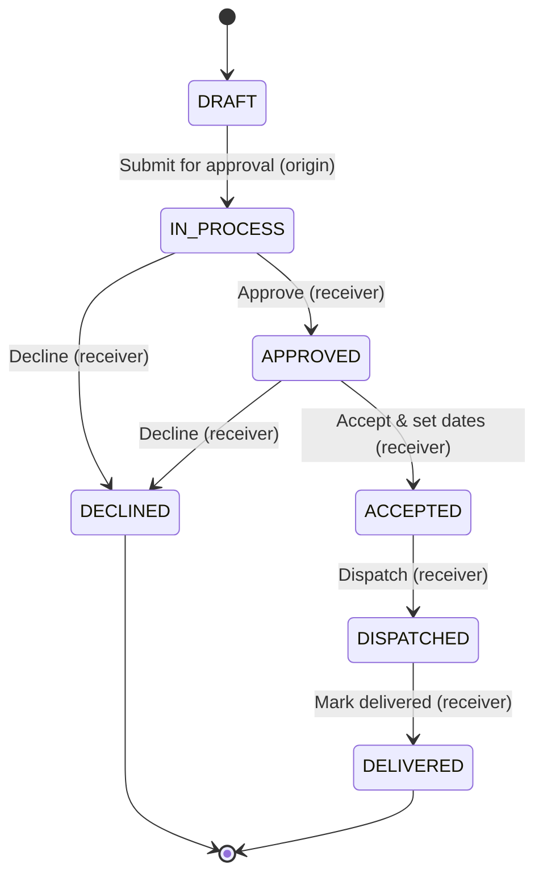

# Application flow

This document describes how people use the PVE Logistics Portal: how they sign
in, the order lifecycle that is the heart of the system, and what each main
screen is for.

## Sign-in

1. A user opens the portal and is redirected to `/login` unless they already
   have a valid session.
2. They sign in with their email and password (Supabase Auth). Accounts that are
   not `ACTIVE` are refused.
3. After sign-in they land in the authenticated area (the "dashboard" layout),
   which provides the sidebar navigation and header shown on every screen.
4. Forgotten passwords are handled through `/forgot-password`, which emails a
   reset link that returns to `/reset-password`.

## Regions and roles

The business operates in four regions — **Argentina, USA, Spain, India** — and
every user belongs to one. What a user can see and do is determined by their
role (`SUPER_ADMIN`, `LOCATION_ADMIN`, `MANAGER`, `STAFF`, `VIEWER`) and, for
most actions, by their region. A `SUPER_ADMIN` works across all regions; other
roles are scoped to their own. See [`../README.md`](../README.md#user-roles) for
the role summary and [`architecture.md`](architecture.md#authorisation) for how
this is enforced.

## The order lifecycle

An order is a request from one region (the **origin**) to another (the
**destination/receiver**). An order corresponds to one shipment — either a sea **container** or an
**air-freight** consignment (`OrderType` is `CONTAINER` or `AIRFREIGHT`). Each
order carries line items (elevator models and/or parts).

The order moves through a fixed set of states. Transitions only go forward; there
are no backward transitions, which keeps the history auditable.

Who can do what, and what each step means:

| From | Action | Who | Result |
| --- | --- | --- | --- |
| `DRAFT` | Submit for approval | Origin region | Order becomes `IN_PROCESS`. |
| `IN_PROCESS` | Approve | Receiving region | Receiver commits to fulfilling; order becomes `APPROVED`. |
| `IN_PROCESS` | Decline (with reason) | Receiving region | Order becomes `DECLINED` (terminal). |
| `APPROVED` | Accept & set dates | Receiving region | Receiver supplies estimated ship and arrival dates; the order is locked and becomes `ACCEPTED`. |
| `APPROVED` | Decline (with reason) | Receiving region | Order becomes `DECLINED` (terminal). |
| `ACCEPTED` | Dispatch | Receiving region | Order becomes `DISPATCHED`. |
| `DISPATCHED` | Mark delivered | Receiving region | Order becomes `DELIVERED` (terminal). |

Notes:

- **Origin vs. receiver.** The origin region creates and submits the order but
  cannot change its status once submitted. Only the receiving region drives the
  approval workflow. (A `SUPER_ADMIN` can act on either side.)
- **Modification requests.** The origin region can request a modification against
  an `APPROVED` or `ACCEPTED` order. This reopens the order as a `DRAFT` so items
  and notes can be edited, after which it is resubmitted.
- **Drafts** can be deleted; orders in any later state are retained for audit.
- **Fill percentage and archiving.** An order/container tracks a fill percentage,
  and completed orders can be archived to keep active lists clean.

## Main screens

All screens below are under the authenticated dashboard layout.

| Screen | Purpose |
| --- | --- |
| **Dashboard** | Landing overview — key figures and recent activity. |
| **Orders** | The core workflow: list, filter, and sort orders; open an order to see its items, status, and the actions available at its current step; create a new order. |
| **Calendar** | Plan and view shipments against ship/arrival dates and route planning windows. |
| **Elevators** | The elevator model catalogue and the elevator configurator (kind, engine, colour, stops, and quantity). |
| **Parts** | The spare-parts catalogue, including CSV import, bulk category assignment, and stock/reorder levels. |
| **Backorders** | Parts that could not be fully fulfilled, tracked against their orders. |
| **Locations** | The four regions and their profiles/teams. |
| **Suggestions** | A feedback box where users submit suggestions and administrators resolve them. |
| **Users** | User administration (create, edit, assign role and region) — available to administrators. |
| **Settings** | Portal settings. |
| **Guide** | An in-app walkthrough of the order flow for new users. |

## Notifications

Order events raise in-app notifications for the relevant users and, when an SMTP
server is configured, matching emails. Without SMTP configured, the email
content is written to the server log, so the workflow functions end-to-end in
development without an email provider.
