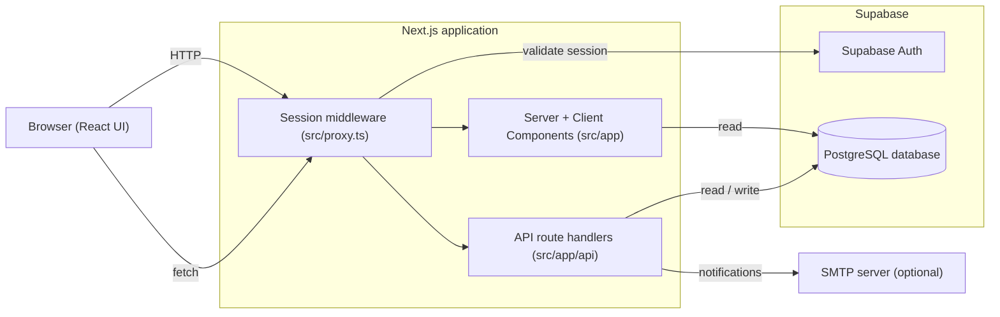

# Architecture

This document describes how the PVE Logistics Portal is put together: the main
components, how a request flows through the system, and how authentication and
authorisation are enforced.

## System overview

The portal is a single Next.js application backed by a Supabase project. There
is no separate backend service — Next.js serves both the user interface (React
Server and Client Components) and the API (route handlers under `src/app/api`).
All persistent data lives in the Supabase PostgreSQL database, and user
authentication is handled by Supabase Auth.

## Layers

- **User interface** (`src/app`, `src/components`) — screens are composed from
  feature-grouped components. Client-side data fetching and caching use TanStack
  Query; lightweight client state uses Zustand; forms use React Hook Form with
  Zod validation.
- **API** (`src/app/api`) — REST-style route handlers for each resource
  (orders, parts, elevators, locations, users, calendar, backorders,
  notifications, suggestions, and authentication). Handlers read the caller's
  identity, check permissions, and read or write the database.
- **Data access** (`src/lib`) — `sb.ts` returns a server-side Supabase client
  used by API handlers and server components. Domain logic that is worth keeping
  out of the handlers lives here too: `permissions.ts` (the capability matrix),
  `order-workflow.ts` (the order state machine), and helpers for capacity,
  calendar planning, CSV import, and email.
- **Database** (`supabase/migrations`) — the schema is defined as ordered SQL
  migrations. Generated TypeScript types for the schema live in
  `src/types/database.ts` and give the application end-to-end type safety.

## Authentication and session handling

Authentication uses Supabase Auth with email and password.

1. A user signs in on `/login`, which calls `POST /api/auth/login`. That handler
   authenticates the credentials against Supabase Auth and loads the matching
   application user profile. Sign-in is refused if the profile is not `ACTIVE`.
2. The session is stored in cookies. On every request, the session middleware in
   [`src/proxy.ts`](../src/proxy.ts) validates the session against Supabase Auth
   and refreshes the session cookie when the access token is close to expiry.
3. Unauthenticated requests to a protected page are redirected to `/login`;
   unauthenticated requests to a protected API route receive `401 Unauthorized`.
4. For authenticated requests, the middleware forwards the user's id, role, and
   region to downstream handlers as request headers.

The public (unauthenticated) routes are `/login`, `/forgot-password`,
`/reset-password`, `/auth/callback`, `/api/auth/login`, and `/api/auth/logout`.
Password reset is handled through Supabase Auth: a reset link returns the user
to `/auth/callback` and then `/reset-password`.

## Authorisation

Authorisation is enforced in the application layer through the capability matrix
in [`src/lib/permissions.ts`](../src/lib/permissions.ts):

- Each of the five roles (`SUPER_ADMIN`, `LOCATION_ADMIN`, `MANAGER`, `STAFF`,
  `VIEWER`) maps to a set of capabilities, and the sets are cumulative.
- **Region scoping**: a `SUPER_ADMIN` may act on any region; other roles may act
  only on resources in their own region.
- **Order transitions** are further restricted to the receiving (destination)
  region — the region an order is sent *to* is the only one that can approve,
  accept, decline, dispatch, or deliver it. See
  [`app-flow.md`](app-flow.md) for the full lifecycle.

> **Note on the data-access path.** The server-side Supabase client returned by
> `src/lib/sb.ts` uses the service-role key and therefore bypasses PostgreSQL
> Row Level Security; authorisation is enforced in application code via the
> capability matrix above. Row Level Security policies also exist in the
> migrations as a secondary layer. A team taking over the project should be
> aware that the capability matrix — not RLS — is the primary enforcement point
> on the current server path.

## Email notifications

Order events generate in-app notifications and, when SMTP is configured, email
(`src/lib/order-emails.ts`, `src/lib/email.ts`). If SMTP environment variables
are not set, email content is written to the server log instead of being sent,
so the application runs without an email provider in development.
