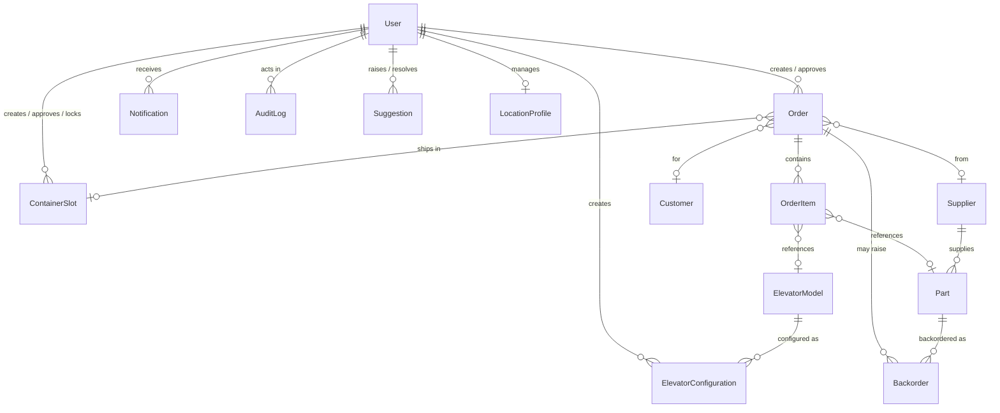

# Data model

This document describes the database schema: the entities and how they relate,
the enumerated types, and a table-by-table reference. The schema is defined by
the ordered SQL migrations in [`../supabase/migrations/`](../supabase/migrations)
and mirrored as TypeScript types in `src/types/database.ts`. Apply the
migrations in filename order. Three files share the `0010` prefix; apply them in
this order: `0010_drop_purchase_orders_unify_containers.sql`,
`0010_order_lifecycle_v2.sql`, `0010b_order_dest_write_lock.sql`.

## Entity-relationship diagram

Relationships without a foreign key (they reference regions via the `Location`
enum rather than a row) are omitted from the diagram:

- **LocationRoute** describes shipping routes between an origin and destination
  region (lead time, preferred weekdays).
- **CalendarEvent** stores scheduled events per region, optionally referencing
  another record via a free-form `refType`/`refId` pair.

## Enumerated types

| Enum | Values |
| --- | --- |
| `UserRole` | `SUPER_ADMIN`, `LOCATION_ADMIN`, `MANAGER`, `STAFF`, `VIEWER` |
| `UserStatus` | `ACTIVE`, `INACTIVE`, `SUSPENDED` |
| `Location` | `ARGENTINA`, `USA`, `SPAIN`, `INDIA` |
| `OrderType` | `CONTAINER`, `AIRFREIGHT` |
| `OrderStatus` | `DRAFT`, `IN_PROCESS`, `APPROVED`, `ACCEPTED`, `DECLINED`, `DISPATCHED`, `DELIVERED` |
| `SlotStatus` | `PLANNED`, `LOCKED`, `APPROVED`, `DISPATCHED`, `DELIVERED`, `CANCELLED` |
| `ContainerSize` | `TWENTY_FT`, `FORTY_FT`, `FORTY_HC` |
| `ElevatorKind` | `CYLINDER`, `CUBE` |
| `ElevatorEngine` | `NONE`, `SPLIT`, `HEAD_UNIT` |
| `BackorderStatus` | `OPEN`, `PARTIALLY_FULFILLED`, `FULFILLED`, `CANCELLED` |
| `NotificationType` | `ORDER_UPDATE`, `CONTAINER_UPDATE`, `PO_APPROVAL`, `BACKORDER_ALERT`, `SYSTEM` |

## Table reference

| Table | Purpose | Key fields |
| --- | --- | --- |
| `User` | Application users. The `id` matches the Supabase Auth user id. | `email`, `role` (`UserRole`), `locationId` (`Location`), `status` (`UserStatus`) |
| `LocationProfile` | Profile for each operating region. | `code` (`Location`), `name`, `country`, `currency`, `managerId` → `User`, `isEnabled` |
| `Order` | A request from an origin region to a destination region; one order = one shipment (a sea container or an air-freight consignment). | `orderNumber`, `type` (`OrderType`: `CONTAINER` or `AIRFREIGHT`), `status` (`OrderStatus`), `originLocation`, `destLocation`, estimated ship/arrival dates, lifecycle timestamps, `fillPercent`, `archivedAt`, `containerNumber`/`routeCounter` (container) or `airNumber`/`airRouteCounter` (air-freight), `slotId` → `ContainerSlot`, `customerId` → `Customer`, `supplierId` → `Supplier` |
| `OrderItem` | A line item on an order — an elevator model or a part, with a quantity. | `orderId` → `Order`, `elevatorModelId` → `ElevatorModel`, `partId` → `Part`, `quantity`, `configJson` |
| `ContainerSlot` | The shipment a set of orders travels in (container or planning slot). | `originLocation`, `destLocation`, `status` (`SlotStatus`), `size` (`ContainerSize`), `containerNumber`, `vessel`, `etd`/`eta`, `fillPercent` |
| `ElevatorModel` | Catalogue of elevator models. | `modelCode`, `name`, `capacity`, `stops`, `isActive` |
| `ElevatorConfiguration` | A named configuration of a model (kind, engine, colour, stops). | `modelId` → `ElevatorModel`, `elevatorKind`, `engine`, `color`, `stops`, `stopsConfig` |
| `Part` | Spare-parts catalogue with stock levels. | `sku`, `name`, `category`, `stockQty`, `reorderLevel`, `supplierId` → `Supplier` |
| `Backorder` | A part quantity that could not be fully fulfilled on an order. | `orderId` → `Order`, `partId` → `Part`, `qtyRequested`, `qtyFulfilled`, `status` (`BackorderStatus`) |
| `Customer` | Customers an order can be placed for. | `code`, `name`, `country`, `location` |
| `Supplier` | Suppliers that provide parts. | `code`, `name`, `country`, `location` |
| `LocationRoute` | Shipping route configuration between two regions. | `originLocation`, `destLocation`, `preferredWeekdays`, `leadTimeDays`, `isActive` |
| `CalendarEvent` | Scheduled events per region, optionally linked to another record. | `title`, `startDate`, `endDate`, `location`, `category`, `refType`/`refId` |
| `Notification` | In-app notifications for a user. | `userId` → `User`, `type` (`NotificationType`), `title`, `message`, `isRead` |
| `Suggestion` | User-submitted feedback. | `createdById` → `User`, `message`, `status`, `resolvedById` → `User` |
| `AuditLog` | Append-only record of actions taken in the system. | `userId` → `User`, `action`, `entity`, `entityId`, `metadata` |
| `PartCategoryCount` | A read-only view that returns the number of parts per category. | `category`, `count` |

> Several tables (`Customer`, `Supplier`, `LocationRoute`, `CalendarEvent`) are
> part of the data model but are not yet populated in the current deployment.
> They support planned functionality and are included here for completeness.
